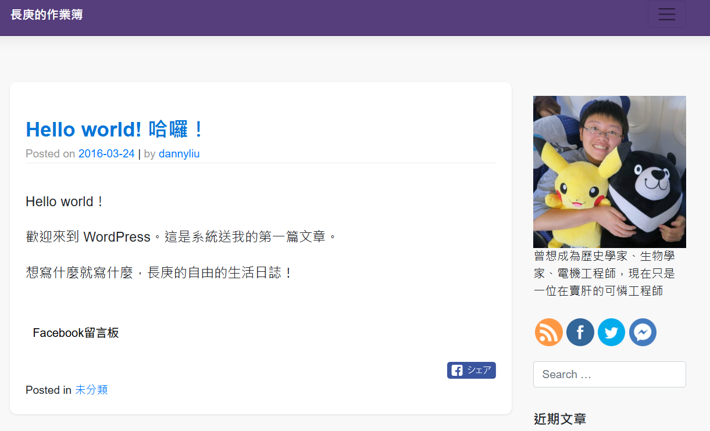
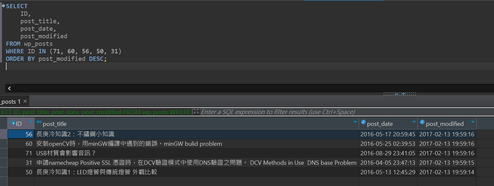
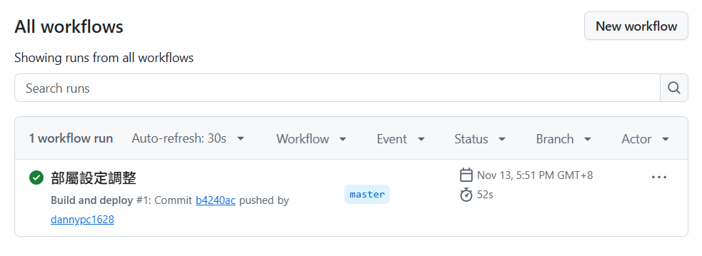
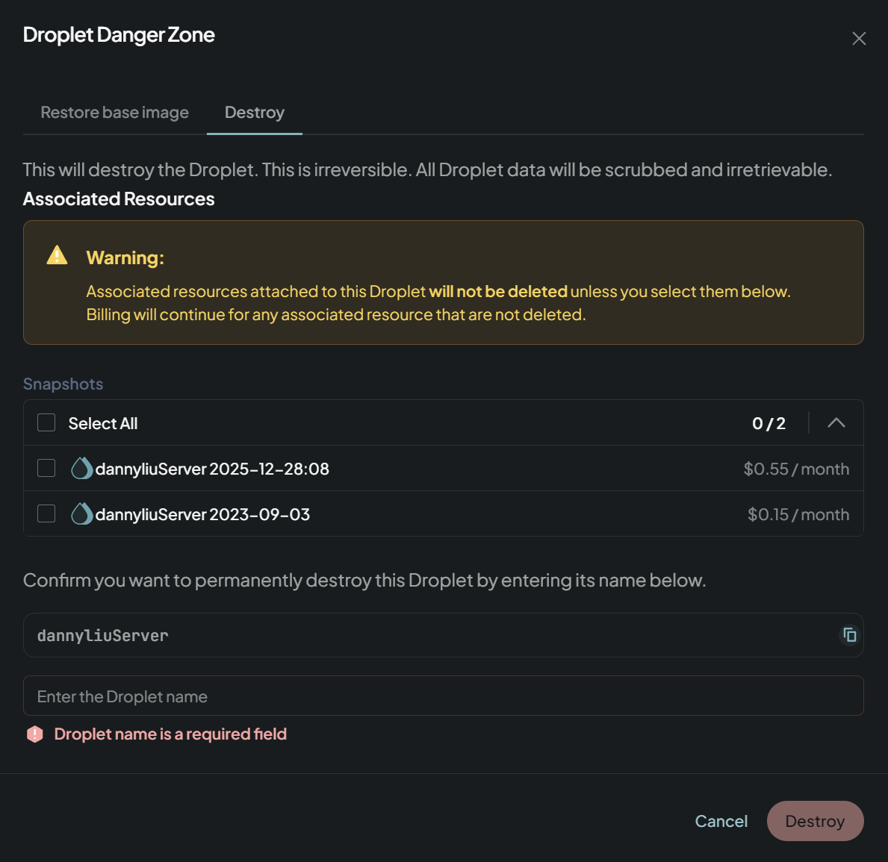

十年前還在大學的時候，為了學習 Linux、PHP 與網站架設，我在 DigitalOcean 租了一台 VPS，自己安裝 Ubuntu、Apache、MySQL 和 WordPress，架設了個人技術部落格 [dannyliu.me](https://dannyliu.me/)。

當年的自己應該沒想到，這台伺服器竟然會一直運作到 2026 年。🤣

隨著工作越來越忙，部落格逐漸荒廢，作業系統、PHP、WordPress 及外掛也很久沒有更新。

最近看到一些 PHP 和 WordPress 的資安議題，突然想到自己還有一台十年沒認真維護的伺服器，決定趁這個機會重新整理網站。

原本只是打算更新 WordPress，沒想到最後直接把整個網站從動態架構搬到 Hugo + GitHub Pages。

這篇文章記錄完整的搬遷過程、遇到的問題，以及最後的處理方式。

---
用 [Wayback Machine](https://web.archive.org/web/20180830191142/https://dannyliu.me/) 看 2018 年的首頁還是用中美堂的照片


那時候還在當兵，後來才換成現在 Bootstrap 的版型。

看第一篇文章發布日期是 `2016-03-24` 這個部落格是真的有 10 年了 🤣



## 一、原本的 WordPress 環境有多古老？

先透過 SSH 登入 DigitalOcean Droplet，確認目前環境。

### Ubuntu 與 Kernel

```bash
cat /etc/os-release
uname -a
```

查詢結果：

| 項目 | 舊環境 |
|---|---|
| 作業系統 | Ubuntu 14.04.6 LTS |
| Linux Kernel | 3.13.0-79-generic |
| PHP | 7.0.33 |
| Apache | 2.4.7 |
| MySQL | 5.5.62 |
| WordPress | 5.8.2 |
| RAM | 1 GB |
| Disk | 25 GB |

其中 Ubuntu 14.04 發布於 2014 年，標準安全維護早已結束；PHP 7.0 和 MySQL 5.5 也都已停止正常安全支援。

這台伺服器的作業系統與應用程式都有相當嚴重的版本老舊問題。

更好笑的是，我連原本的 sudo 密碼都忘記了。XDDDD

原本只是想更新網站，最後發現與其冒險在這台老主機上升級，不如重新建立一套乾淨的網站。

### 主機使用量

```bash
df -h
free -h
du -sh /var/www/wordpress
du -sh /var/www/wordpress/wp-content/uploads
```

得到的結果：

| 項目 | 大小 |
|---|---:|
| 磁碟總容量 | 25 GB |
| 磁碟已使用 | 4.8 GB |
| WordPress 網站 | 577 MB |
| wp-content | 527 MB |
| uploads 圖片 | 306 MB |
| WordPress 資料庫 | 約 17.69 MB |

其實網站資料量不大，完全沒有必要為了保存這些文章，繼續維護一台完整的 Linux VPS。

當時每月包含備份功能的費用約 US$7，一年大約 US$84。

雖然不算貴，但真正麻煩的是系統維護與資安風險。

---

## 二、為什麼最後決定改用 Hugo？

這次主要評估了幾種方案：

- 繼續使用 DigitalOcean，重新安裝最新版 Ubuntu、PHP、MySQL 和 WordPress。
- 搬到 WordPress.com、Blogger、痞客邦等現成部落格平台。
- 使用 Hugo 或 Astro 等靜態網站產生器，再部署到 GitHub Pages。

**自己架設網站雖然自由度高，但維護成本與技術門檻也相對較高。** 就像這次的舊 WordPress，每個環節都需要自行管理，從作業系統、Web Server、PHP、資料庫到 WordPress 外掛，不僅要定期更新，還得承擔各種資安風險。

至於 WordPress.com、Blogger、痞客邦等現成部落格服務，雖然省去了主機維護的麻煩，但又讓我想到當年無名小站關站的經驗。平台是否能長期經營，終究不是使用者能控制的，難免擔心有一天又得重新搬家。

**最後選擇 Hugo + GitHub Pages，主要是看中維護成本低、資料自主性高，以及長期保存的便利性。**

GitHub 是目前全球工程師廣泛使用的程式碼託管平台，擁有成熟的生態系，相較於自行維護 VPS，可以大幅降低日常維運負擔。雖然不能保證平台永遠不會停止服務，但 Hugo 的文章都是 Markdown，原始碼與圖片也能透過 Git 完整備份在自己的電腦上，即使未來需要更換平台，也能輕鬆搬遷，不必被單一服務綁住。

唯一的小門檻，就是需要熟悉 Git 版本控制及 GitHub Actions 自動部署。不過對工程師來說，這些操作基本上就是小菜一碟。🤣

最重要的是，未來不用再維護 PHP、MySQL 和 WordPress，也不需要每個月支付 VPS 主機費用。對於偶爾更新的個人技術部落格而言，這樣的架構反而更加單純、自由且長久。

最後決定使用：

**Hugo + PaperMod + GitHub Pages**

主要原因是，這個部落格只是用來保存個人技術筆記、文章與照片，不需要會員系統、動態資料庫或複雜的後台功能。

Hugo 的特點包括：

1. 使用 Markdown 撰寫文章。
2. 不需要 PHP 與 MySQL。
3. 建置速度快，部署後只有靜態檔案。
4. 可以使用 Git 管理文章版本。
5. 可以免費部署到 GitHub Pages。
6. 支援自訂網域與 HTTPS。

我也評估過 Astro。Astro 使用 JavaScript / TypeScript 生態系，對於需要客製化元件、整合 Vue 或 React 的網站更有彈性。

不過這次主要目標是搬遷舊文章，而不是重新開發一套前端網站，因此選擇架構相對單純的 Hugo。

---

## 三、先完整備份 WordPress

正式搬遷前，第一件事不是安裝 Hugo，而是把原始資料完整保存下來。

我先建立備份資料夾：

```bash
mkdir -p ~/wp-backup-20261110
```

### 1. 備份 MySQL 資料庫

由於原本的 WordPress 資料表採用 `utf8mb4_unicode_ci`，因此匯出時明確指定 `utf8mb4`。

```bash
set -o pipefail
umask 077

mysqldump \
  -u DB_USER \
  -p \
  --single-transaction \
  --quick \
  --default-character-set=utf8mb4 \
  wordpress \
  | gzip > ~/wp-backup-20261110/wordpress-utf8mb4.sql.gz

echo $?
```

這裡有兩個很實用的 Shell 設定：

`set -o pipefail`：避免 mysqldump 失敗，但 gzip 成功，導致整條管線錯誤地回傳成功。

`umask 077`：讓新建立的備份檔案預設只有目前使用者可以讀寫，避免資料庫備份被其他帳號讀取。

備份完成後，再確認壓縮檔是否正常：

```bash
gzip -t ~/wp-backup-20261110/wordpress-utf8mb4.sql.gz
```

### 2. 備份 WordPress 網站檔案

```bash
tar -czf \
  ~/wp-backup-20261110/wordpress-files.tar.gz \
  -C /var/www wordpress
```

這裡遇到第一個小問題：

```text
tar: wordpress/test/abc.html:
Cannot open: Permission denied
```

原來是以前亂玩的測試檔案 `abc.html`，檔案擁有者是 root，權限為 `600`，一般使用者無法讀取。

確認這個測試檔不需要搬遷後，重新備份並排除它：

```bash
tar -czf \
  ~/wp-backup-20261110/wordpress-files.tar.gz \
  --exclude='wordpress/test/abc.html' \
  -C /var/www wordpress
```

最後產生的備份檔案約為：

| 檔案 | 壓縮後大小 |
|---|---:|
| wordpress-files.tar.gz | 397 MB |
| wordpress.sql.gz（初次備份） | 691 KB |

另外重新建立了使用 utf8mb4 的資料庫備份。

接著透過 SCP 將備份下載到 Windows 電腦，保留原始檔案，不直接在舊主機上修改資料。

---

## 四、確認 WordPress 究竟有多少文章

原本以為十年累積了很多文章，結果查完 MySQL 才發現：

```sql
SELECT
    post_type,
    post_status,
    COUNT(*) AS total
FROM wp_posts
WHERE post_type IN ('post', 'page')
GROUP BY post_type, post_status;
```

結果：

| 類型 | 狀態 | 數量 |
|---|---|---:|
| post | publish | 56 |
| post | draft | 39 |
| page | private | 2 |

十年來其實只有 56 篇公開文章。🤣

這次搬遷只處理公開文章，39 篇草稿與 2 個私人頁面保留在原始資料庫備份，不放到 GitHub 公開網站。

另外查詢文章內容的格式：

```sql
SELECT
    COUNT(*) AS total_posts,
    SUM(post_content LIKE '%[code%') AS code_posts,
    SUM(post_content LIKE '%[sourcecode%') AS sourcecode_posts,
    SUM(post_content LIKE '%[gallery%') AS gallery_posts,
    SUM(post_content LIKE '%<pre%') AS pre_posts
FROM wp_posts
WHERE post_type = 'post'
  AND post_status = 'publish';
```

得到：

| 內容特徵 | 文章數 |
|---|---:|
| 公開文章 | 56 |
| 包含 `<pre>` | 29 |
| 包含 `[code` | 4 |
| 包含 `[sourcecode` | 0 |
| 包含 `[gallery` | 0 |

代表有超過一半的文章包含程式碼或預格式化內容，搬遷時必須特別注意 Markdown 程式碼區塊的轉換。

---

## 五、MySQL 查詢中文字全部變亂碼？

在 Ubuntu 的 MySQL CLI 查詢文章時，遇到第二個問題。

文章的英文和 HTML 標籤都正常，但中文字幾乎全部變成亂碼。

一開始很擔心，難道十年前的文章資料已經損壞？

先查詢 MySQL 的字元集：

```sql
SHOW VARIABLES LIKE 'character_set%';
```

結果發現：

- MySQL Client：utf8
- MySQL Connection：utf8
- MySQL Results：utf8
- Database 預設：latin1
- Server 預設：latin1

接著檢查 WordPress 文章欄位：

```sql
SHOW FULL COLUMNS FROM wp_posts
WHERE Field IN ('post_title', 'post_content');
```

確認 `post_title` 和 `post_content` 實際使用的都是：

```text
utf8mb4_unicode_ci
```

再使用 HEX 查詢文章原始位元組：

```sql
SELECT
    ID,
    HEX(post_title),
    LENGTH(post_title),
    CHAR_LENGTH(post_title)
FROM wp_posts
WHERE ID = 1568;
```

結果可以看到有效的 UTF-8 中文編碼。

最後確認 Linux 終端機輸出的 UTF-8 位元組：

```bash
printf '\xE4\xB8\xAD\xE6\x96\x87\n' | od -An -tx1
```

結果：

```text
e4 b8 ad e6 96 87 0a
```

這正是「中文」兩個字的 UTF-8 編碼。

因此，問題很可能出在終端機的中文字元顯示或解碼環節，而不是資料庫內容全面毀損。

這裡學到一件事：**遇到中文亂碼，先確認資料庫欄位編碼與原始位元組，不要直接修改資料表字元集。**

否則原本正常的資料，可能真的被轉壞。

---

## 六、使用 Docker + MariaDB 在 Windows 還原資料庫

為了不再依賴老舊 Ubuntu，我決定把 WordPress 資料庫還原到 Windows 電腦。

電腦上剛好有五年前安裝的 Docker Desktop，居然還能正常運作！XDDDD

先確認：

```cmd
docker info
docker ps -a
```

Docker Engine 正常啟動，只看到一個五年前停止的 Ubuntu 容器。

於是另外建立 MariaDB 10.11：

```cmd
docker run -d --name wp-migrate ^
  -e MARIADB_ROOT_PASSWORD=YOUR_LOCAL_PASSWORD ^
  -e MARIADB_DATABASE=wordpress ^
  -p 127.0.0.1:3307:3306 ^
  mariadb:10.11
```

其中 `YOUR_LOCAL_PASSWORD` 是本機專用的臨時密碼。

再確認 MariaDB：

```cmd
docker logs --tail 30 wp-migrate
```

看到：

```text
mariadbd: ready for connections
```

代表資料庫已經啟動。

### 匯入 SQL 遇到密碼問題

第一次匯入時使用：

```cmd
docker exec -i wp-migrate mariadb -uroot -p wordpress < backup.sql
```

結果出現：

```text
ERROR 1045 (28000):
Access denied for user 'root'@'localhost'
```

原因是 CMD 的 `<` 將 SQL 檔案送入標準輸入，而 MariaDB 的 `-p` 也需要互動式讀取密碼，導致密碼輸入流程衝突。

後來改用本機臨時環境變數提供密碼：

```cmd
set "WP_DB_PASSWORD=YOUR_LOCAL_PASSWORD"

docker exec -i -e MYSQL_PWD="%WP_DB_PASSWORD%" ^
  wp-migrate mariadb -uroot ^
  --default-character-set=utf8mb4 wordpress ^
  < "wordpress-utf8mb4.sql"

set "WP_DB_PASSWORD="
```

正式使用時，SQL 檔案需改成實際完整路徑。這種方式只適合本機臨時資料庫，不應拿正式環境密碼照抄使用。

最後使用 DBeaver 連線：

```text
Host: 127.0.0.1
Port: 3307
Database: wordpress
Username: root
```

資料庫成功匯入，20 張 WordPress 資料表都在，而且 56 篇公開文章的標題、日期與繁體中文內文均能正常查詢。

---

## 七、使用 C# 將 WordPress 文章批次轉成 Hugo Markdown

資料庫完成還原後，開始真正的文章搬遷。

因為自己平常主要使用 C# 開發，所以直接建立一個 .NET 9 Console App，讓程式自動從 MariaDB 讀取文章，轉換成 Hugo 使用的 Markdown。

專案名稱：

```text
WordPressToHugo
```

安裝 NuGet 套件：

```bash
dotnet add package MySqlConnector
dotnet add package ReverseMarkdown
```

`MySqlConnector` 負責連接 MariaDB，`ReverseMarkdown` 則負責將 HTML 轉成 Markdown。

基本流程：

```text
MariaDB
   ↓
讀取 wp_posts
   ↓
關聯分類與標籤
   ↓
HTML → Markdown
   ↓
產生 Hugo Front Matter
   ↓
輸出 content/posts/*.md
```

主要 SQL 條件：

```sql
WHERE p.post_type = 'post'
  AND p.post_status = 'publish'
```

只轉換公開文章，避免草稿與私人頁面被公開。

另外，WordPress 的分類和標籤分別儲存在：

- `wp_terms`
- `wp_term_taxonomy`
- `wp_term_relationships`

轉換程式會把這些資料整理成 Hugo Front Matter。

例如：

```yaml
---
title: "在 .NET 7 中，使用 MailKit 寄信遇到 SMTP 錯誤"
date: "2023-07-12T14:43:13+08:00"
draft: false
url: "/原本的文章網址/"
categories:
  - ".NET"
tags:
  - "C#"
---
```

為了避免中文檔名或特殊字元造成問題，實體 Markdown 檔案直接使用 WordPress 文章 ID 命名：

```text
content/posts/
├── 1586.md
├── 1568.md
├── 1554.md
└── ...
```

原本的文章網址則透過 Front Matter 的 `url` 保留。

### 保留 WordPress 原始網址

在資料庫確認到原本的永久連結規則：

```text
/%postname%/
```

因此轉換時將 WordPress 的 `post_name` 解碼後，設定成 Hugo 的 `url`。

例如原始網址：

```text
https://dannyliu.me/文章名稱/
```

搬遷後也盡量維持相同路徑。

這樣有機會保留原本的搜尋引擎索引與外部分享連結，不必全部重新導向。

中文 Slug 需要額外檢查百分比編碼，避免轉換時發生二次編碼。

---

## 八、建立 Hugo + PaperMod 網站

安裝 Hugo Extended 後，建立新網站：

```cmd
hugo new site dannyliu-hugo
cd dannyliu-hugo
git init
```

安裝 PaperMod：

```cmd
git submodule add https://github.com/adityatelange/hugo-PaperMod.git themes/PaperMod
```

再把 C# 產生的 Markdown 複製進：

```text
content/posts/
```

原本 WordPress 的圖片則放到：

```text
static/wp-content/uploads/
```

這樣就能保留文章中的圖片路徑，例如：

```markdown

```

### 第一次啟動就遇到 404

執行：

```cmd
hugo server -D
```

結果首頁出現：

```text
Page Not Found
```

檢查 Log：

```text
WARN found no layout file for "html" for kind "home"
WARN found no layout file for "html" for kind "page"
```

原來是 `hugo.toml` 沒有正確設定主題。

補上：

```toml
baseURL = "https://dannyliu.me/"
title = "Danny Liu's Blog"
theme = "PaperMod"
timeZone = "Asia/Taipei"

[params]
  mainSections = ["posts"]
  disableSpecial1stPost = true
  ShowReadingTime = true
  ShowPostNavLinks = true
  ShowCodeCopyButtons = true
```

重新啟動 Hugo 後，PaperMod 首頁終於正常顯示。

看到十年前的 WordPress 文章出現在新的深色部落格頁面，還真的有種考古文物重新出土的感覺。🤣

### 確認 56 篇文章都有成功匯入

```cmd
dir /b content\posts\*.md | find /c /v ""
```

結果：

```text
56
```

再執行：

```cmd
hugo list all | find /c "content/posts/"
```

結果同樣是：

```text
56
```

代表 Hugo 已經辨識全部 56 篇 Markdown，沒有漏掉文章。

---

## 九、HTML 轉 Markdown 遇到的問題

雖然文章成功匯入，但部分舊 WordPress HTML 並不適合直接轉成 Markdown。

### 1. 程式碼區塊

因為有 29 篇文章包含 `<pre>`，所以特別檢查 C#、Git、Angular 和 MailKit 等文章的程式碼格式。

抽查後，幾篇主要技術文章的顯示結果正常。

不過 HTML → Markdown 的轉換並非百分之百無損，因此仍需要針對表格、短代碼及特殊 HTML 做後續檢查。

### 2. YouTube iframe 被 Hugo 忽略

Hugo 建置時出現：

```text
WARN Raw HTML omitted while rendering
content/posts/555.md
```

打開 `555.md` 才發現，原本的電影心得文章最後有一段：

```html
<iframe
  src="https://www.youtube-nocookie.com/embed/tNwrx9dEgLs"
  width="640"
  height="360">
</iframe>
```

Hugo 的 Goldmark 預設不會輸出 Markdown 裡的原始 HTML。

不想為了單一影片開啟全站不安全 HTML 渲染，因此改用 Hugo 的 YouTube Shortcode：

```text
{{ < youtube tNwrx9dEgLs > }}
```



再於 `hugo.toml` 設定：

```toml
[privacy.youTube]
  privacyEnhanced = true
```

這樣就能正常嵌入影片，也保留 YouTube 的隱私增強模式。

---

## 十、搬遷時意外發現 2017 年的可疑垃圾連結

這算是整次搬遷最意外的插曲。

某次 Hugo 建置時，因為一篇舊文章包含不合法網址，整個建置過程失敗：

```text
invalid URL escape
```

回頭查看 WordPress 資料庫，發現部分早期文章出現奇怪的外部短網址，例如：

```text
biturlz.com
```

甚至在 OpenCV 技術文章中出現與內容完全無關的藥品廣告文字。

這些連結也破壞了正常的 HTML 標籤，導致 ReverseMarkdown 轉換後產生不合法的 Markdown。

進一步查詢幾篇文章的修改時間：

```sql
SELECT
    ID,
    post_title,
    post_date,
    post_modified
FROM wp_posts
WHERE ID IN (31, 50, 56, 60, 71);
```


發現五篇不同時間發布的文章，最後修改時間全部集中在：

**2017 年 2 月 13 日 19:59:14～19:59:16**

再統計同一分鐘內修改的文章，發現共有六篇，其中五篇包含已知的可疑連結特徵。

這很像過去常見的 SEO Spam Injection，也就是有人利用網站漏洞或帳號權限，在文章內插入垃圾廣告連結。

不過，僅憑資料庫內容與修改時間，無法證實當年究竟發生了什麼，也無法確認入侵途徑。

### WordPress Revision 原來也會保存歷史文章

調查時還發現 `wp_posts` 中有多筆標題相同的文章。

進一步檢查：

```sql
SELECT
    ID,
    post_parent,
    post_type,
    post_status,
    post_title
FROM wp_posts
WHERE post_parent IN (31, 50, 56, 60, 71);
```

確認這些不是重複發布，而是 WordPress 的文章修訂版本：

```text
post_type = revision
post_status = inherit
post_parent = 原文章 ID
```

部分較早的 Revision 與現在的文章內容不同，代表資料庫仍保有歷史編輯紀錄。

不過這次搬遷的目標不是數位鑑識，實在不想繼續追查九年前發生的事情。XDDDD

最後先手動移除五篇 Markdown 中確認的可疑連結，並在 C# 轉換工具中加入已知垃圾網域的偵測與清理規則，以及異常網址報告。

原始 SQL 備份則完整保留，不直接修改歷史資料。

這件事情也提醒我：**將舊網站轉成靜態網站前，最好先檢查內容本身是否有污染，不要把舊問題原封不動搬到新站。**

---

## 十一、部署 Hugo 到 GitHub Pages

完成本機測試後，決定使用 GitHub Pages 免費託管新網站。

我的 GitHub 帳號是 `dannypc1628`，因此建立 Repository：

```text
dannypc1628.github.io
```

使用這個命名方式，可以讓 GitHub Pages 使用網域根目錄：

```text
https://dannypc1628.github.io/
```

比使用一般專案 Repository 的子目錄網址，更方便測試原本以 `/` 開頭的文章及圖片路徑。

### GitHub Actions 自動部署

在 Repository 建立：

```text
.github/workflows/hugo.yaml
```

使用 Hugo 官方的 GitHub Actions 部署流程，讓 GitHub 在 Push 後自動：

1. Checkout Repository。
2. 初始化 PaperMod Git Submodule。
3. 安裝 Hugo 建置工具。
4. 執行 Hugo Build。
5. 上傳靜態網站產物。
6. 部署至 GitHub Pages。

另外把建置時區改成台灣：

```yaml
env:
  TZ: Asia/Taipei
```

### GitHub Actions 一直沒有執行？

原本以為 Workflow 設定完成後就會自動執行，結果 GitHub Actions 顯示：

```text
There are no workflow runs yet.
```

檢查後才發現，原本 `hugo.yaml` 的觸發條件是：

```yaml
on:
  push:
    branches:
      - main
```

但是 Repository 實際使用的分支名稱是：

```text
master
```

因此 Workflow 根本沒有符合觸發條件。

修改為：

```yaml
on:
  push:
    branches:
      - master
  workflow_dispatch:
```

重新 Commit、Push 後，GitHub Actions 終於正常執行，而且 Build 與 Deploy 都成功。

以後更新文章，只要：

```bash
git add .
git commit -m "Update blog posts"
git push origin master
```

GitHub Actions 就會自動重新建置並發布網站。



---

## 十二、將 dannyliu.me 切換至 GitHub Pages

確認 GitHub Pages 已經部署成功後，接著處理自訂網域。

在 GitHub Repository 的：

**Settings → Pages → Custom domain**

填入：

```text
dannyliu.me
```

接著到 DNS 管理平台，將根網域的 A Records 指向 GitHub Pages：

| Type | Name | Value |
|---|---|---|
| A | @ | 185.199.108.153 |
| A | @ | 185.199.109.153 |
| A | @ | 185.199.110.153 |
| A | @ | 185.199.111.153 |

並確認 GitHub Pages 可以使用 HTTPS。

完成 DNS 切換後，原本的：

```text
https://dannyliu.me/
```

便改由 GitHub Pages 提供 Hugo 靜態網站。

整個過程不需要更換網域，也不用繼續租用 Linux VPS。

### 舊的 DigitalOcean 怎麼處理？

在確認新站正常、資料庫及圖片備份完成後，就可以準備退休舊 Droplet。

但要注意，DigitalOcean 的 Power Off 並不會停止主機計費，必須正式 Destroy Droplet，主機費用才會停止。

另外原本還保留兩份 Snapshot：

- 2025 年的系統快照：US$0.55／月
- 2023 年的系統快照：US$0.15／月

這些快照如果沒有一起刪除，仍可能繼續計費。

所以在刪除主機前，要先確認所有重要資料都已經備份，並決定是否保留歷史快照。


---

## 十三、搬遷前後的比較

| 項目 | 舊 WordPress | 新 Hugo |
|---|---|---|
| 網站類型 | 動態網站 | 靜態網站 |
| 作業系統 | Ubuntu 14.04 | GitHub Pages 代管 |
| Web Server | Apache 2.4 | GitHub Pages |
| PHP | PHP 7.0 | 不需要 |
| 資料庫 | MySQL 5.5 | 不需要 |
| CMS | WordPress 5.8.2 | Hugo |
| 主題 | WP Bootstrap Starter | PaperMod |
| 文章格式 | MySQL / HTML | Markdown |
| 文章管理 | WordPress 後台 | Git |
| 發布方式 | WordPress | GitHub Actions |
| HTTPS | 自行管理 | GitHub Pages |
| 主機費用 | 約 US$7／月 | US$0（免費額度內） |
| 自訂網域 | dannyliu.me | dannyliu.me |

不包含網域本身的續費與可能的其他服務費用。

Hugo 雖然仍需要定期更新建置工具和相依項目，但因為線上網站不再執行 PHP、WordPress 外掛或 MySQL，公開服務的攻擊面大幅縮小。

對這種偶爾才會更新的個人技術部落格而言，相當適合。

---

## 十四、這次搬遷學到了什麼？

回頭看這次搬遷，最大的收穫其實不只是省下每月 US$7 的主機費。

而是重新理解了網站架構、資料備份、字元編碼與部署自動化的重要性。

整理幾個值得記錄的心得：

**1. 不要在沒有完整備份的情況下升級老系統。**

尤其是跨越十年以上的作業系統與應用程式版本，直接原地升級的風險往往比重建還高。

**2. 文章內容與網站執行環境應該盡可能分離。**

WordPress 資料庫可以透過轉換工具輸出成 Markdown，並不需要永遠綁在 PHP 與 MySQL 上。

**3. 遇到中文亂碼，先檢查編碼，不要直接修改資料庫。**

這次差點以為所有中文文章都壞掉，結果在 Windows DBeaver 裡完全正常。

**4. HTML 轉 Markdown 不一定百分之百正確。**

尤其是程式碼、iframe、Shortcode、損壞的 HTML 和特殊網址，仍然需要人工檢查。

**5. GitHub Actions 的分支名稱要對應正確。**

Repository 使用 `master`，Workflow 卻監聽 `main`，是這次部署時最單純、卻也最容易忽略的問題。

**6. 老網站搬遷也是一次內容安全健檢。**

這次意外發現多篇文章存在可疑垃圾連結，提醒自己即使網站還能正常瀏覽，也不代表內容或環境完全安全。

---

## 結語：十年的部落格，換一種方式繼續保存

從大學時期為了學 Linux 而租用的 DigitalOcean VPS，到現在把網站搬到 Hugo + GitHub Pages，這台伺服器陪伴了我大約十年。

這次原本只是擔心 PHP 太舊、網站可能遭到攻擊，想說趕快整理一下。

沒想到最後從備份、MySQL、Docker、C#、Markdown、Hugo、GitHub Actions，一路重新學習了一遍。

甚至還意外挖出 2017 年疑似被插入垃圾連結的歷史紀錄，真的是 IT 考古。🤣

雖然只有 56 篇公開文章，但每一篇都是當時學習技術、研究問題留下的紀錄。

現在終於不需要為了保存這些文章，繼續維護一台 Ubuntu 14.04 的老伺服器。

未來只要編輯 Markdown、Commit、Push，就能透過 GitHub Actions 自動更新網站。

**十年的 WordPress 時代告一段落，dannyliu.me 改用 Hugo 繼續營運。**

希望下一次再回來整理部落格，不會又是十年後。XDDDD

---

**相關技術**

- [Hugo](https://gohugo.io/)
- [PaperMod](https://github.com/adityatelange/hugo-PaperMod)
- [GitHub Pages](https://pages.github.com/)
- [GitHub Actions](https://github.com/features/actions)
- [MariaDB](https://mariadb.org/)
- [MySqlConnector](https://mysqlconnector.net/)
- [ReverseMarkdown](https://github.com/mysticmind/reversemarkdown-net)

**文章標籤：** WordPress、Hugo、GitHub Pages、DigitalOcean、Docker、MariaDB、C#、網站搬遷、靜態網站、GitHub Actions
